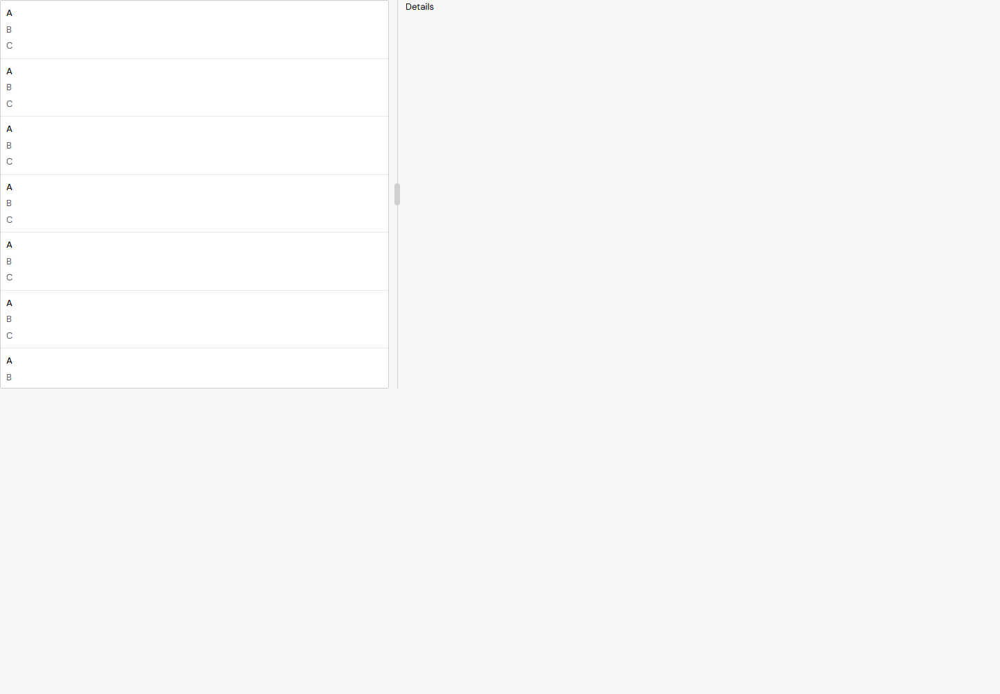
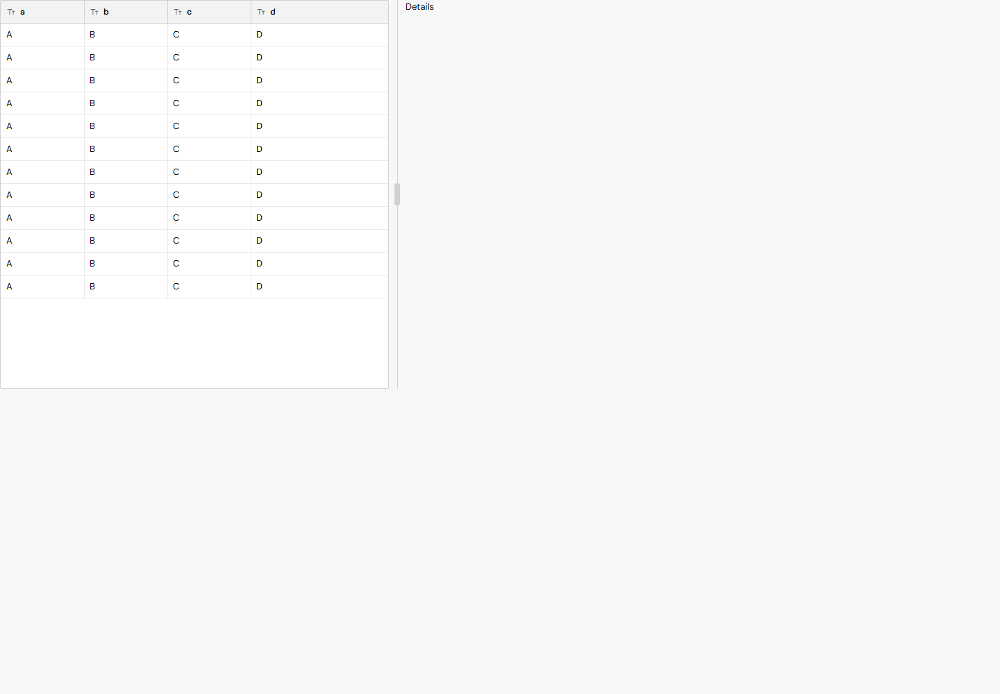

# SplitView default layout (168)

Intended appearance change: at the same 560px list-pane width, a grid now shows its columns as a table instead of switching to the key-column list. The application can still request narrow="list" explicitly; standalone defaults are unchanged.

The four cases verify pane default table, explicit list, explicit table, and standalone default list. Actual widths and the 600px threshold are recorded. The standalone fixture is constrained by its own container, not a rule overriding the component's width. The exact-base test fails the pane default; head passes all cases. Screenshots use the same light-mode fixture and were visually inspected.

Before (exact base 61577d19):

After:

