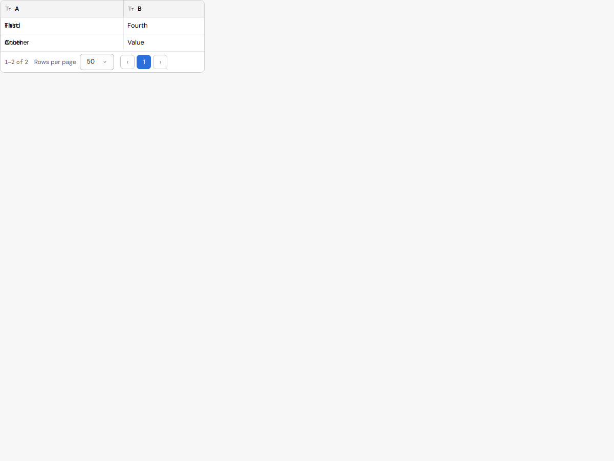
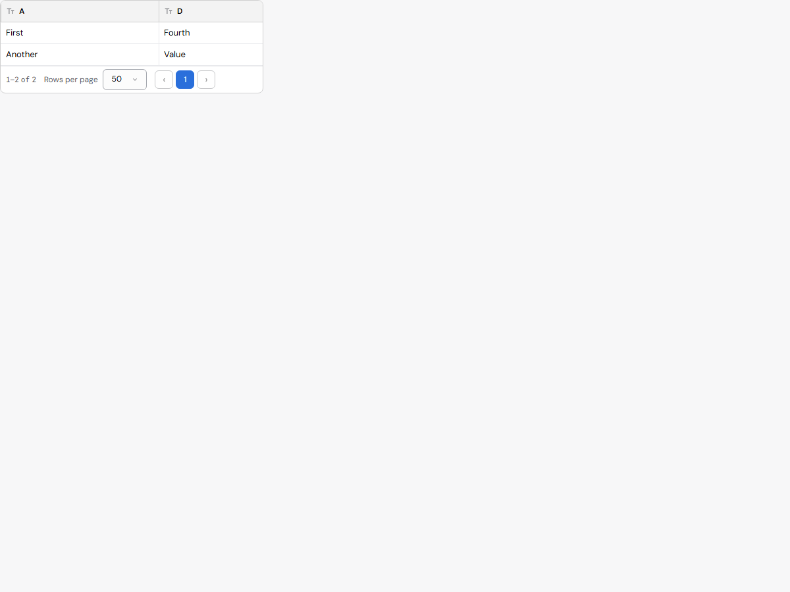

# Issue 147: horizontal header alignment

Exact base: f500fa5eab9a3ee843c8976a884d8409d92fd52b, design-system a9db5ad1566951bb0cdc817a90ac0f07192be68d. Both versions were built with portable Node 22 on the same Chrome runner. The same regression test was copied to a detached exact-base checkout; it fails there and passes all 18 scenarios on the fix. All assertions remain enabled.

At scrollLeft=300 the original header remains at zero because its inner overflow container clips away the outer header's scroll extent (398px rather than the body's 960px). The fix exposes that extent to the existing body-to-header scroll handler. Header scrollLeft then equals body scrollLeft, with columns aligned.

The expanded test also exposed frozen RTL cells choosing a sticky side from their automatic content direction. Frozen grid cells now inherit the grid's layout direction; their content keeps automatic bidi in a display-contents wrapper (or its existing render slot). Static Table's content markup is unchanged. Frozen headers use the existing raised layer, and frozen cells inherit their row's existing background/state so scrolling fields cannot paint through them.

The eighteen cases cover LTR/RTL scrolling, header/body alignment, pinned header hit visibility, frozen row backgrounds, wider/narrower viewports, sorting, hiding/reordering/resizing columns, two frozen columns, custom cell links, and Arabic/English content whose direction opposes the grid. before.json and after.json contain measured offsets and coverage. The screenshot pair uses the same LTR fixture at scrollLeft=480: before has header B over column D and text painting through the pinned field; after has header D over D and an opaque, readable pinned field.

Before:

After:

Reproduce: set CHROME_PATH, build the checkout, then run `node tests/data-grid-scroll-147.test.js`. SCROLL_SCREENSHOTS optionally saves the scrolled fixture. No baseline or shared test was changed; no new colors, sizing tokens or design variants were introduced.

The existing DataGrid behavior test invokes this regression when DataGrid changes, so the same eighteen assertions run in the normal CI behavior job.

## CI follow-up

CI run 39358268885 passes build, accessibility, labs 2 and 3, and GRID_SCROLL_OK (18 cases). The broader suite remains red.

The full unchanged DataGrid assertions were run on the same local Node 22 / Chrome runner against exact base f500fa5e and freshly rebuilt source head 96e77dd4. Both produce DATA_GRIDS_FAIL 26/42 table views. All per-view success/failure lines and contract-check results match exactly; no new table finding appears on head. See base-all-grids.txt and head-all-grids.txt. Head additionally passes GRID_SCROLL_OK 18 cases. No assertion, tolerance or baseline was relaxed.

The earlier sampled-head run used a restored generated bundle and is superseded by this freshly rebuilt full comparison. The other CI groups have not been fully attributed against this exact base; this evidence only establishes the existing table-suite failures. System and specification gates pass (1056 files; 1171 leaves, 767 records).
